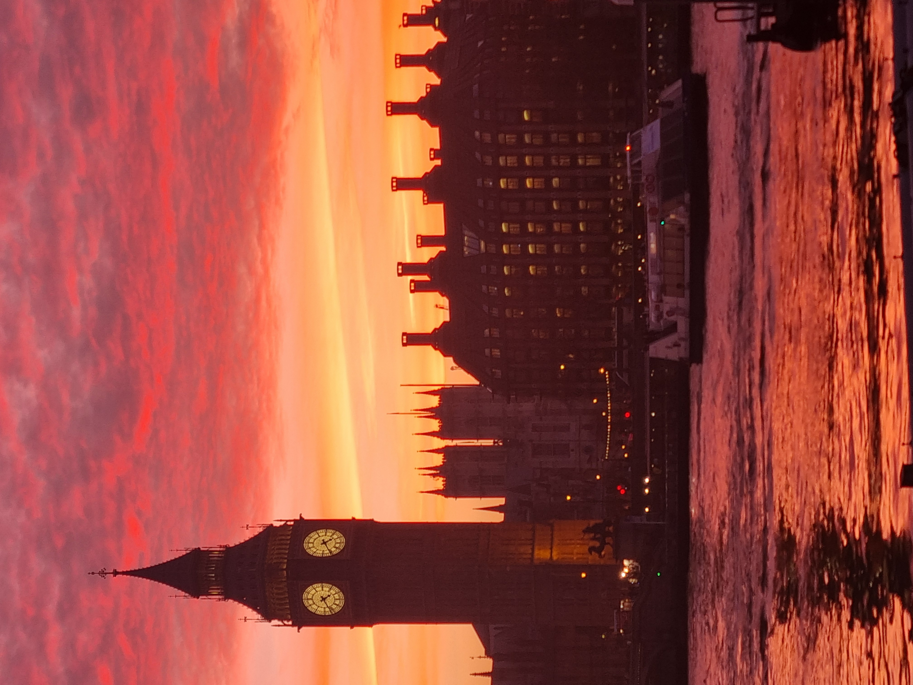
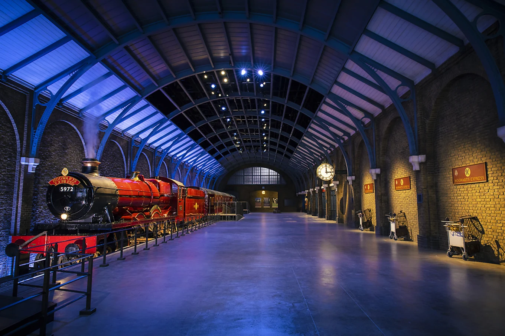

**영국**(United Kingdom)은 찬란한 역사와 수백 년의 전통, 그리고 현대 문화가 완벽하게 조화를 이루는 매력적인 나라입니다. 흔히 '신사의 나라'로 불리는 영국은 고풍스러운 클래식함과 현대적인 다채로움이 공존하는 독특한 문화적 매력을 지니고 있습니다.

붉은색 이층 버스와 공중전화 부스가 정겨운 풍경을 더해주는 세계적인 대도시 **런던**을 비롯해, 화려한 왕실의 전통을 간직한 **버킹엄 궁전**, 그리고 내셔널 갤러리와 테이트 모던 등 세계적인 명화와 현대 미술을 품은 미술관들까지 볼거리가 가득합니다.

셰익스피어와 비틀스, 해리 포터의 고향이자 고전적인 고딕 건축물과 아름다운 자연 풍경이 공존하는 영국으로 여러분을 초대합니다.

> 📷 이미지 출처: [클룩(Klook)](https://www.klook.com/ko/blog/harry-potter-warner-bros-studio-tour-tokyo-guide/)

### 🎡 런던의 풍경을 한눈에, 런던 아이 (The London Eye)
템스강 변에 위치한 대형 관람차로, 현대 런던을 상징하는 대표적인 랜드마크입니다. 캡슐에 탑승해 높이 오르면 빅벤과 국회의사당은 물론 런던 시내 전체를 360도 파노라마 뷰로 한눈에 담을 수 있습니다. 특히 해 질 녘 노을과 함께 펼쳐지는 런던의 야경은 매혹적인 분위기를 선사합니다.

### 🧙‍♂️ 마법 세계로의 특별한 여정, 해리포터 스튜디오 (Warner Bros. Studio Tour London)
세계적인 사랑을 받은 영화 <해리포터> 시리즈의 제작 현장을 그대로 옮겨 놓은 체험형 전시관입니다. 호그와트 마법학교의 대연회장, 9와 4/3 승강장, 다이애건 앨리 등 실제 촬영 세트장과 의상, 소품들을 눈앞에서 직접 확인하며 영화 속 마법 세계로 들어간 듯한 몰입감을 선사합니다.
